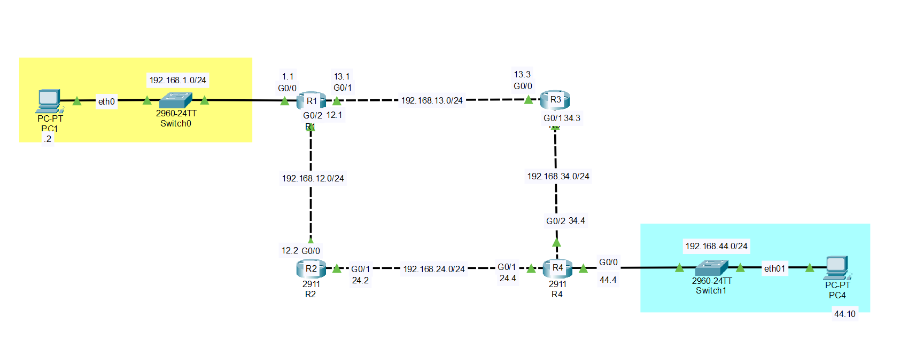
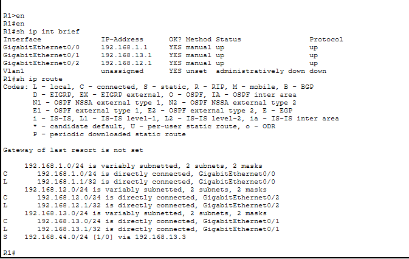
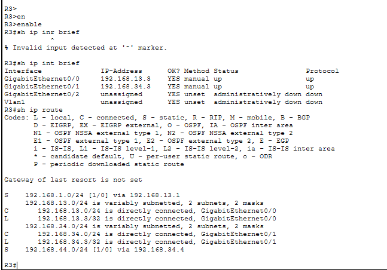
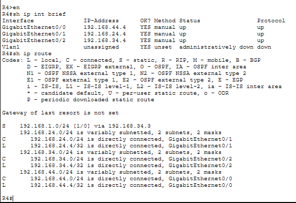

# Lab 03: Static Routing

## Objective
Configure static routing across a four-router network so that PC1 and PC4 can communicate with each other.

## Topology & Configuration

[static routing file](lab03-static-routing.pkt)

- 2 PCs: PC1 and PC4
- 4 Routers: Router1, Router2, Router3, Router4
- 2 Switches (one for each PC)

## Network Connections
- PC1 → Switch → Router1
- Router1 → Router2 → Router4
- Router1 → Router3 → Router4
- Router4 → Switch → PC4

## What I Configured
- Assigned IP addresses to all router interfaces
- Configured static routes on each router using the `ip route` command
- Set the IP address, subnet mask and default gateway on PC1 and PC4
- Verified the routing tables using `show ip route`
- Tested end-to-end connectivity with a ping from PC1 to PC4

## Problems I Faced and How I Solved Them

### Problem 1: Configuration applied to the wrong interface
- The router interface `G0/0` was connected to the switch, but I configured `G0/1` by mistake.
- Cause: I used the "Automatic" connection type in Packet Tracer, which picked `G0/1` on its own, and I did not verify it.
- Solution: I checked the interface used by each cable and configured the correct one.

### Problem 2: Wrong interface type between the PC and the switch
- I used `GigabitEthernet0/1` between the PC and the switch, but it should have been `FastEthernet0/1`. The PC interface was also FastEthernet.
- Solution: I selected `FastEthernet0/1` on both ends.

## Key Takeaways
- Do not rely on the "Automatic" cable option. Always verify which interface is being used.
- Note down the interface of every link on the topology before starting the configuration.
- Use `show ip interface brief` to check which interfaces are up.

## Tools
Cisco Packet Tracer, Cisco IOS CLI

## Files
- `topology.png`: network diagram
- `Router1_config.png`: Router 1 config
- `Router3_config.png`: Router 3 config
- `Router4_config.png`: Router 4 config
- `lab03-static-routing.pkt`: Packet Tracer file
- Screenshots: ping test and routing table
